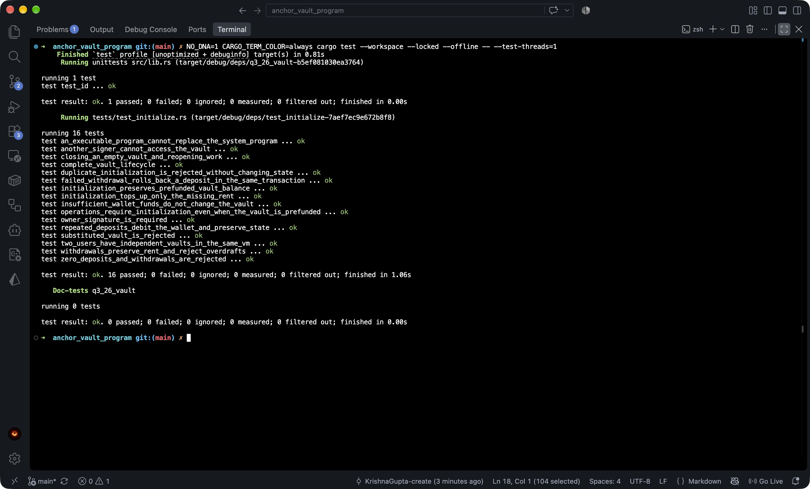

# SOL vault

An Anchor program with one SOL vault per signing wallet. Amounts are in lamports
(1 SOL = 1,000,000,000 lamports).

| Instruction | Behavior |
| --- | --- |
| `initialize()` | Creates the state account and funds the vault's rent reserve. Existing vault funds are preserved. |
| `deposit(amount)` | Transfers a positive amount from the signing wallet into its initialized vault. |
| `withdraw(amount)` | Returns a positive amount to the signing wallet while preserving the vault's rent reserve. |
| `close()` | Returns all remaining vault SOL and the state account's rent, then closes the vault state. |

The state PDA uses `[b"state", user_pubkey]`; the system-owned vault PDA uses
`[b"vault", user_pubkey]`. Both are checked against the signing wallet on every
instruction. The state stores their canonical bumps. Withdrawals and closure sign
System Program transfers with the vault PDA seeds. A closed vault must be
initialized again before deposits or withdrawals.

## Build and test locally

Use Anchor CLI 1.1.2 and the Rust toolchain pinned in `rust-toolchain.toml`.

```sh
NO_DNA=1 anchor build --ignore-keys
NO_DNA=1 cargo test --workspace --locked
NO_DNA=1 cargo fmt --all --check
```

`--ignore-keys` preserves the existing declared program address while building for
LiteSVM: the locally generated deployment keypair currently has a different
address. Align the deployment keypair and declared program address before deploying.

The 16 integration tests in `programs/q3_26_vault/tests/test_initialize.rs` load
`target/deploy/q3_26_vault.so` at runtime, so rebuild after changing program code.
They cover the full lifecycle, rent preservation, invalid amounts, unauthorized
access, account and program substitution, duplicate initialization, prefunded
vaults, reopening after closure, repeated deposits, insufficient wallet funds,
transaction rollback, and isolation between users sharing one VM. All transactions
run inside LiteSVM.

To run just the LiteSVM suite after building:

```sh
NO_DNA=1 cargo test --test test_initialize --locked
```

## Test results

All **17 tests pass**: 16 LiteSVM integration tests and 1 program-ID unit test.


